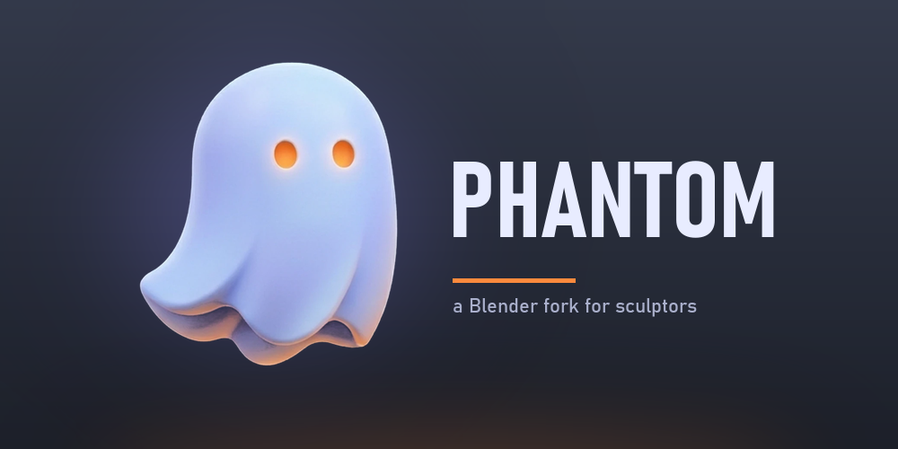

<!--
Phantom's read-me. Keep the feature list in step with CHANGELOG.md.
See 'release/text/readme.html' for Blender's end user read-me.
-->

Phantom
=======

Phantom is a fork of [Blender](https://www.blender.org) tuned for sculpting: ZBrush-style
masking, face sets and Transpose, a live silhouette preview, quick brushes, a large matcap
library, a charcoal look with cozy interface sounds, and many smaller quality-of-life changes.
Everything else in Blender is still there and works as before.

**[Download Phantom 0.2.0](https://github.com/Potassiums/phantom/releases/latest)** (Windows, 64-bit).
Unzip it anywhere and run `phantom.exe`; nothing needs installing. Phantom keeps its settings in
`%APPDATA%\Phantom`, apart from any Blender install.

Phantom is in **alpha** and follows Blender's in-development code (currently 5.4): save often.

New in 0.2.0
------------

- **Transpose:** ZBrush's action line for moving, scaling and rotating the unmasked model, plus
  Move/Rotate/Scale icons (gizmo or Transpose) in the middle of the Sculpt tool header. **W** is
  Move.
- **Matcap library tools:** 54 ZBrush-style matcaps, search inside the matcap grid, favorites
  with gold stars, a default matcap for every project, four quick slots and "new!" badges.
- **Face sets like ZBrush:** Ctrl+W makes a face set from the mask, Ctrl+Shift-click isolates.
- **Limited, Maya-style grid**, a pulsing vertex hover in Edit Mode, Halloween edit-mode colors,
  masks that stay visible with overlays off, and a shorter Properties tab list while sculpting.

See [CHANGELOG.md](CHANGELOG.md) for everything that changed in each release.

Controls
--------

Phantom keeps Blender's controls except where listed here. Keys are for the default keymap.

### Sculpt Mode: masking and face sets

| Control | On the mesh | Off the mesh |
|---|---|---|
| **Ctrl-drag** | Paint a mask | Box mask. A box that misses the mesh clears the mask, or voxel-remeshes when nothing is masked |
| **Ctrl+Alt-drag** | Erase the mask | Box-erase the mask |
| **Ctrl-click** | Smooth the mask | Invert the mask |
| **Ctrl+Alt-click** | Sharpen the mask | |
| **Ctrl+W** | Turn the masked area into a face set and clear the mask | |
| **Ctrl+Shift-click** | Isolate that face set; on an isolated one, show the others instead | Show everything |
| **Ctrl+Shift-drag** | Trim with the trim tool selected in the toolbar | |
| **Ctrl+F** | Show/hide face sets with the wireframe (PolyFrame) | |

### Sculpt Mode: brushes and tools

| Control | Action |
|---|---|
| **Shift** (hold) | Smooth (the Brush Asset preview shows the brush that will be used) |
| **Alt** (hold) | Invert the brush |
| **X** | Toggle X symmetry |
| **W** | Move (gizmo or Transpose, as chosen in the tool header) |
| **C** | With a paint or smear brush: sample the mesh's color. Otherwise Clay Strips, or your quick brush on C |
| **R** / **Ctrl+R** | Set the remesh voxel size (with a measuring tick sound) / voxel remesh |
| **Ctrl+Alt+F** | Brush texture angle (Ctrl+F is PolyFrame) |
| **Right-click** | Brush menu, with **Focal Shift** (hardness) and **Stabilize Stroke** |
| **Quick brush slots** (sidebar, under Brush Asset) | Click to use, drag brushes in or out, right-click to replace, remove or assign a shortcut; a shortcut takes over its key |
| **Tool header icons** (middle) | Move, Rotate, Scale, then Gizmo or Transpose |
| **Remesh / Quad Remesh** (tool header) | Voxel remesh settings / AutoRemesher quad retopology |

### Transpose action line

Pick Move, Rotate or Scale in the tool header, then:

| Control | Action |
|---|---|
| **Click-drag on the model** | Draw a new action line; its ends snap to the surface |
| **Drag an end's outer ring** | Move that end (in the plane of the screen) |
| **Drag the middle ring or the line** | Move the whole line |
| **Drag the middle's inner circle** | Move: move the model (**Shift**: along the line). Scale: thicken or thin it across the line. Rotate: twist it around the line |
| **Drag an end's inner circle** | Move: stretch/shear it. Scale: scale it about the other end. Rotate: rotate it about the other end |
| **Right-click / Esc** while dragging | Cancel |

Masked areas don't move, symmetry is respected, and **Ctrl+Z** undoes each drag. Masking
(Ctrl-drag) still works while Transpose is active.

### Matcaps (Solid shading, Matcap lighting)

| Control | Action |
|---|---|
| **Click the matcap thumbnail** | Open the matcap grid; **type** to search it (typos are fine) |
| **Star next to the search** | Show only favorites |
| **Right-click a matcap** | Set as Default Matcap, Add to/Remove from Favorites, Add to Quick Slot |
| **Magnifying glass** next to the thumbnail | Search matcaps by name |
| **Quick Matcaps** (Shading popover) | Click a slot to switch; **+** stores the current matcap; right-click to replace or clear |
| **Per Object** (Shading popover) | Apply the matcap to the selected objects, or back to the viewport's |

### Viewport and interface

| Control | Action |
|---|---|
| **Overlays > Guides > Infinite / Limited** | Blender's floor or a square Maya-style grid (Grid Size, Axis Colors) |
| **Ghost button** (viewport header, Sculpt Mode) | Show or hide the silhouette thumbnail; drag it to move, its corner to resize, next to the tools to dock |
| **Asset shelf button** (viewport header, Sculpt Mode) | Show or hide the brush asset shelf |
| **Hover a vertex** (Edit Mode, vertex select) | The vertex a click would select pulses |
| **Edit > Preferences > Interface > Sounds** | Turn interface sounds on or off, and set their volume |

What Phantom adds to Blender
----------------------------

### Look and feel

- **Phantom theme:** charcoal gradients with blue-purple accents, periwinkle selection, the
  Phantom ghost icon and splash, 3 px object outlines and larger vertices and edges.
- **Halloween edit-mode colors:** pumpkin-orange selection, witch-purple active element,
  purple-black unselected cage, slime-green seams.
- **Cozy interface sounds** (Animal Crossing inspired), with volume and on/off in
  Preferences > Interface > Sounds: clicks, toggles, menus, soft "pop" confirms and cancels for
  placing things (grab, rotate, scale, remesh, applying modifiers, loop cuts), undo/redo,
  typing taps with pitch variation, outliner clicks, loop add/remove and slide ticks, knife
  snips, mode switching and a measuring tick when resizing the remesh voxel size.
- **Motion:** tools collapse and cascade in when switching modes; menus and dropdowns slide out
  from the side they open toward, with submenus sliding out from under their parent; the N
  sidebar slides in and out.
- **Navigation gizmo** shows which side you are facing (Front, Right, Top...).
- **File > New > Sculpting** starts looking straight at the front of the sphere.

### Viewport

- **Limited or infinite grid** (Overlays popover): a square, Maya-style grid around the origin
  with an adjustable size and optional axis colors, or Blender's infinite floor.
- **Vertex hover:** in Edit Mode, the vertex a click would select grows a little and pulses.
- **Per-object matcaps:** give selected objects their own matcap, or send them back to the
  viewport's.

### Matcaps

- **54 extra ZBrush-style matcaps** ship with Phantom, by
  [Mandarin](https://mandarin.gumroad.com/l/zbrush-style-matcaps-for-blender).
- **Search** the matcap grid as you type (fuzzy: typos and partial words are fine), or use the
  search button next to the matcap thumbnail.
- **Favorites:** star matcaps from their right-click menu (gold stars in the grid) and filter the
  grid to favorites.
- **Default matcap:** right-click a matcap to use it for every new project.
- **Quick matcaps:** four slots in the Shading popover for one-click switching.
- **"new!" badges** on matcaps you add, until you use them.

### Sculpt Mode

- **Silhouette thumbnail:** a live black-on-white view of the scene, docked in the top-left
  corner with the viewport's aspect ratio. Move, resize and dock it; it follows the sidebar.
- **ZBrush-style masking:** Ctrl-drag to mask (off the mesh: box mask, or clear the mask / voxel
  remesh when empty), Ctrl-Alt-drag to erase, Ctrl-click to smooth (on the mesh) or invert (off
  it), Ctrl-Alt-click to sharpen. Alt inverts the brush.
- **Masks stay visible** with viewport overlays off.
- **Face sets:** Ctrl+W turns the masked area into a face set and clears the mask;
  Ctrl+Shift-click isolates a face set, swaps on an isolated one and shows everything off the
  mesh; Ctrl+F toggles face sets plus wireframe (PolyFrame).
- **Move, Rotate and Scale** (W is Move) with five icons in the middle of the tool header: pick
  the action, and Blender's gizmo or the **Transpose** action line.
- **Transpose:** ZBrush-style action line. Draw it on the model; drag its rings to place it and
  its inner circles to move, stretch, scale, thicken or thin, rotate or twist the unmasked model.
  Masks, symmetry and undo work as expected.
- **Quad Remesh** (powered by [AutoRemesher](https://github.com/huxingyi/autoremesher))
  with its own dropdown next to Remesh; settings saved with the file.
- **Brushes:** the sidebar moves next to the tools with the Brush Asset panel (tool icon and name
  on top) and four quick-brush slots: drag brushes in or out, right-click to replace, remove or
  give a shortcut. A quick-brush shortcut takes over its key (for example C instead of Clay
  Strips).
- **Brush preview updates live** while holding Shift (smooth), Ctrl (mask) or Ctrl+Shift (trim).
- **Focal Shift** (brush hardness) slider in the brush's right-click menu; the cursor's inner
  ring follows it, like ZBrush.
- **Stabilize Stroke** (lazy mouse) toggle in Brush Settings.
- **X** toggles X symmetry; **Ctrl+Shift-drag** trims with the selected trim tool.
- **C** samples the mesh's color while a paint or smear brush is active.
- **Asset shelf** toggle in the header.
- **Properties editor** shows only the tabs that matter while sculpting, plus a Sculpting tab
  (coming soon).

Building
--------

Phantom builds like Blender: see Blender's
[build instructions](https://developer.blender.org/docs/handbook/building_blender/). On Windows,
`make.bat ninja` in the repository builds `phantom.exe`.

When cloning from GitHub, set `GIT_LFS_SKIP_SMUDGE=1` for the initial clone to avoid Git LFS
errors, then get Blender's large files as described in Blender's
[cloning instructions](https://developer.blender.org/docs/handbook/contributing/using_git/clone_update/#github-mirror). Phantom's branding, theme, sound and
icon generators are in [tools/phantom/branding](tools/phantom/branding).

Credits
-------

- [Blender](https://www.blender.org) by the Blender Foundation and its contributors.
- [AutoRemesher](https://github.com/huxingyi/autoremesher) by Jeremy Hu (MIT), used by Quad
  Remesh.
- The ZBrush-style matcaps ("ZB ..." in the matcap list) are by **Mandarin**:
  [ZBrush Style Matcaps for Blender](https://mandarin.gumroad.com/l/zbrush-style-matcaps-for-blender)
  on Gumroad. They're $2, or free with the code **FREE** that Mandarin provides; if you like them,
  consider supporting him there.

License
-------

Phantom, like Blender, is licensed under the GNU General Public License, Version 3.
Individual files may have a different but compatible license.

See [blender.org/about/license](https://www.blender.org/about/license) for details.
